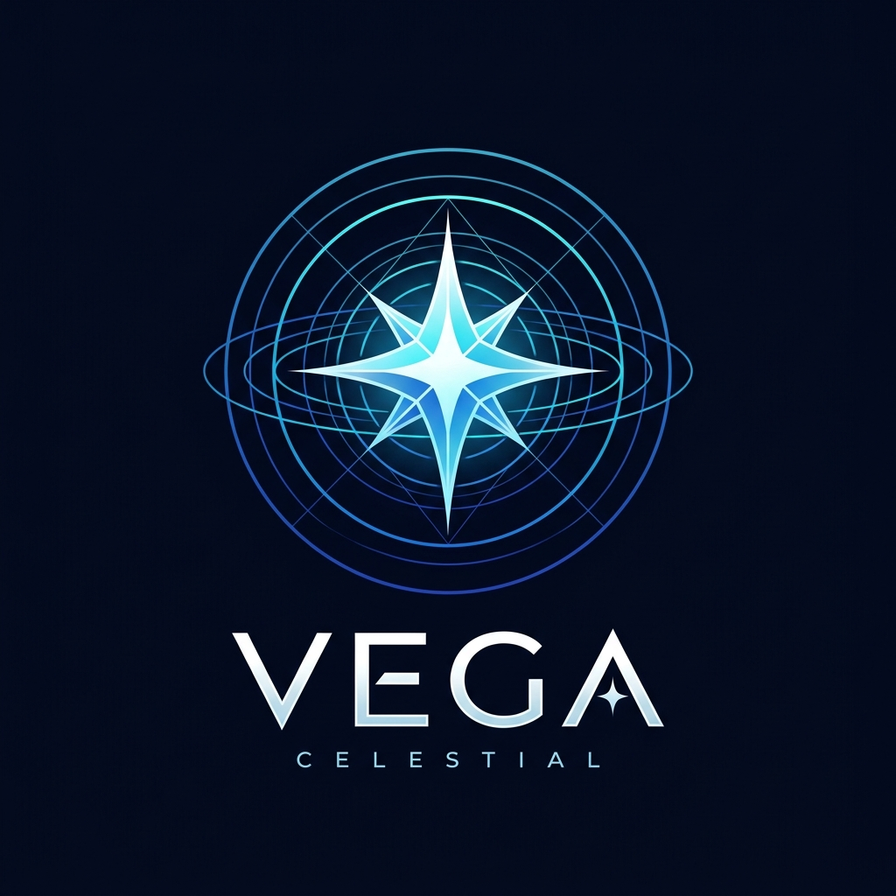
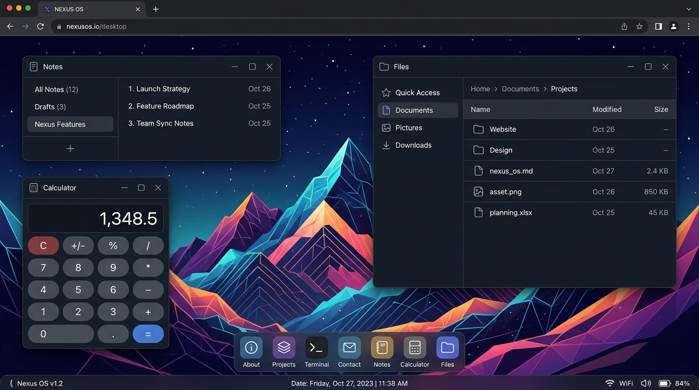
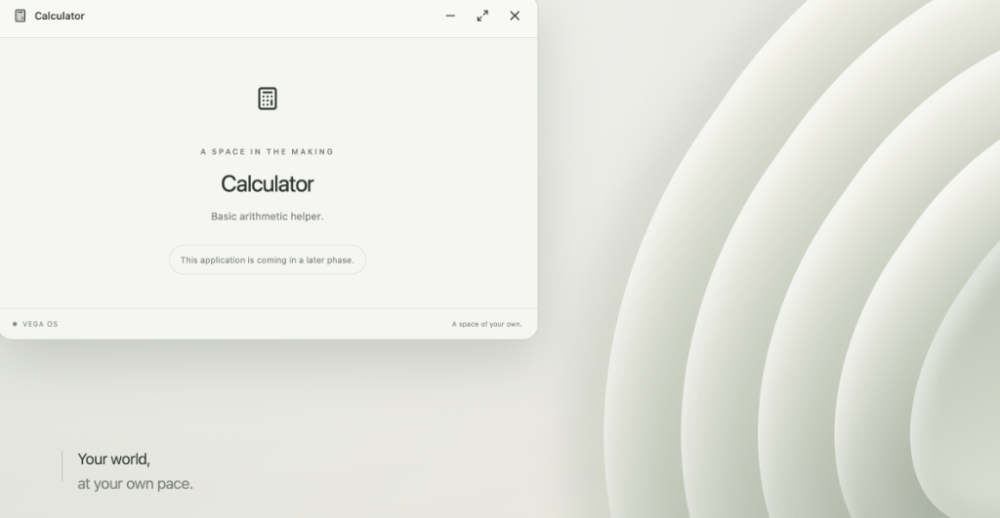

# <p align="center"><br />VEGA OS</p>

<p align="center">
  <strong>A calm, spatial desktop operating environment running natively in the modern browser.</strong>
</p>

<p align="center">
  
  
  
  
  
  
</p>

---

> ⚠️ **Project Status: Active Work in Progress (WIP)**  
> VEGA OS is under active development. Core desktop features, window management, spatial 3D rendering, and system applications are functional, with ongoing refinements to animations, settings persistence, and hardware integration.

---

## 📸 Visual Previews

### 1. Spatial Desktop & 3D Workspace


### 2. Multi-Window Management & System Apps


---

## ✨ Key Highlights & Features

### 🌌 Spatial 3D Workspace
- **Three.js & React Three Fiber integration**: Organic, minimalist 3D sculptures that react calmly in the desktop environment.
- **Restrained Spatial Depth**: Configured with strict z-indexing and pointer-event passthrough to ensure zero interference with UI controls.
- **Toggleable via Quick Settings**: Seamlessly switch between the 3D spatial experience and a lightweight 2D canvas.

### 🪟 Comprehensive Window Management
- **Desktop Workspace Bounds**: Full window boundaries respect the system topbar and persistent dock.
- **True Desktop Maximization**: Windows expand to cover the available workspace, remembering previous un-maximized positions and sizes.
- **Persistence Across Sessions**: Window geometry, active states, and custom positions persist across app minimize, close, and reopen cycles.
- **Smart Stacking & Focus**: Multi-window layering with clean z-index stacking order and active window elevation.
- **Smooth Window-Aware Desktop Transitions**: The desktop wallpaper and clock smoothly fade when an app window is active, bringing focus directly to your work.

### 🌐 VEGA Web Browser
- **Tab Bar Lifecycle**: Create, duplicate, pin, and close independent browser tabs.
- **Configurable Search Engines**: Default Google search query resolution with persistent engine switching (Google, DuckDuckGo, Bing).
- **URL Normalization**: Automatic protocol resolution (`example.com` ➔ `https://example.com/`).
- **Bookmarks Manager**: Create bookmark folders, nest items, edit titles/URLs, and search bookmarks.
- **Sandboxed Security Diagnostics**: Detects and gracefully handles `X-Frame-Options` and CSP-blocked domains with fallback navigation.

### 🔋 Hardware-Aware System Shell
- **Dynamic Web Battery API**: Real-time battery percentage tracking with charging status indicators in the system topbar and Quick Settings.
- **Universal Spotlight Search**: Fast multi-index search across apps, files, and notes.
- **Quick Settings & Notification Center**: Control simulated Wi-Fi, Bluetooth, volume levels, Do Not Disturb (DND), and theme palettes.

---

## 📱 Built-in System Applications (11 Core Apps)

| Application | Description | Technology |
| :--- | :--- | :--- |
| **🌐 VEGA Browser** | Full-featured web browser with tabs, bookmarks, and search | React + Iframe Sandbox |
| **📁 File Manager** | Hierarchical virtual file system (VFS) with folder navigation | IndexedDB / Virtual FS |
| **⚡ Terminal** | UNIX-inspired interactive shell with custom commands and help | Virtual Command Dispatcher |
| **📝 Notes** | Rich note-taking workspace with instant search and snippet preview | IndexedDB Storage |
| **📄 Text Editor** | Plain-text scratchpad and code editor | Controlled React State |
| **📊 Task Manager** | Real-time process and window inspector with memory metrics | Window State Manager |
| **⚙️ Settings** | OS preferences, 3D workspace toggle, wallpaper palettes, themes | LocalStorage Sync |
| **🔢 Calculator** | Clean arithmetic and standard mathematical helper | React Calculator Engine |
| **💼 Projects** | Interactive portfolio showcase for software and designs | Modular Grid Components |
| **ℹ️ About VEGA OS** | System runtime specifications, kernel info, and update checker | Web Storage API |
| **✉️ Contact** | Form-validated contact and messaging portal | Input Validation Suite |

---

## 🚧 Roadmap & Work in Progress

- [x] **Core Window Engine**: Drag, resize, maximize/restore bounds calculation.
- [x] **Browser Subsystem**: Tabs, history, search engines, bookmarks manager.
- [x] **Hardware Indicators**: Live Battery Status API and audio feedback hooks.
- [x] **Minimalist 3D Canvas**: Three.js WebGL scene with zero UI obstruction.
- [x] **Automated Test Harness**: 56 unit and audit tests passing.
- [ ] **Dock Hide Animation**: Smooth dynamic dock auto-hide when apps are maximized.
- [ ] **Virtual Desktop Workspaces**: Multi-desktop workspace switching with animated slide transitions.
- [ ] **Persistent File Cloud Sync**: Optional remote synchronization for Notes and VFS files.
- [ ] **App Store / Plugin System**: Dynamic third-party web app sandboxing.

---

## 🛠️ Tech Stack & Architecture

- **Runtime & UI**: [React 19](https://react.dev/), [TypeScript 5.7](https://www.typescriptlang.org/)
- **Build Tool**: [Vite 6](https://vitejs.dev/)
- **Styling**: [Tailwind CSS 4](https://tailwindcss.com/) + Custom Glassmorphic CSS variables
- **3D Graphics**: [Three.js](https://threejs.org/) + [@react-three/fiber](https://docs.pmnd.rs/react-three-fiber)
- **Icons**: [Lucide React](https://lucide.dev/)
- **Testing**: Node.js Native Test Runner (`node --test`)

```
NEXUS_OS_Phase_2_Complete/
├── public/                 # Static assets, PWA manifest, and screenshots
│   ├── vega-logo.png       # Official VEGA OS celestial logo
│   └── screenshots/        # Readme preview images
├── src/
│   ├── apps/               # 11 System applications
│   ├── components/         # QuickSettings, Notifications, Search, 3D Workspace
│   ├── windows/            # WindowManager state reducer and window container
│   ├── App.tsx             # Root desktop environment, dock, and topbar
│   ├── battery.ts          # Web Battery API integration
│   ├── audio.ts            # Sound synthesis and system audio
│   ├── browserUtils.ts     # Bookmark, tab, and search engine logic
│   └── searchUtils.ts      # Universal search indexer
└── tests/                  # 56 automated test suites
```

---

## 🚀 Getting Started

### Prerequisites
- **Node.js**: v20+ or v22+
- **npm**: v10+

### Installation

1. **Clone the repository:**
   ```bash
   git clone https://github.com/<your-username>/vega-os.git
   cd vega-os
   ```

2. **Install dependencies:**
   ```bash
   npm install
   ```

3. **Start the local development server:**
   ```bash
   npm run dev
   ```
   Open your browser at `http://localhost:5173`.

4. **Run the test suite:**
   ```bash
   npm test
   ```
   All 56 automated unit tests and audit checks will execute.

5. **Build for production:**
   ```bash
   npm run build
   npm run preview
   ```

---

## 🧪 Testing & Verification

VEGA OS includes comprehensive automated test coverage verifying:
- Application registry and metadata audits
- Window manager reducer states (open, focus, minimize, maximize, bounds calculation, persistence)
- Browser tab lifecycle, bookmarks deduplication, and Google query encoding
- Web Battery API state parsing and fallbacks
- Universal search ranking and fuzzy matching
- Quick Settings toggles and notification dispatchers

---

## 📄 License

This project is licensed under the [MIT License](LICENSE).
